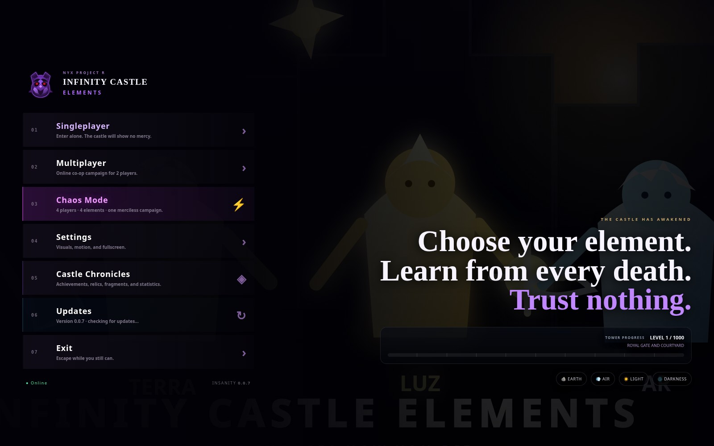
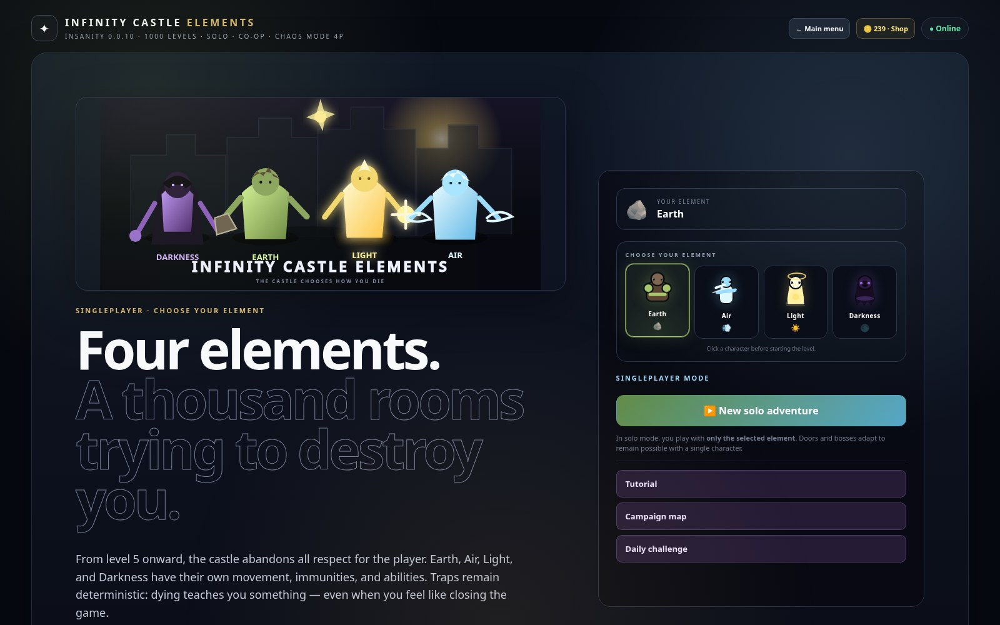
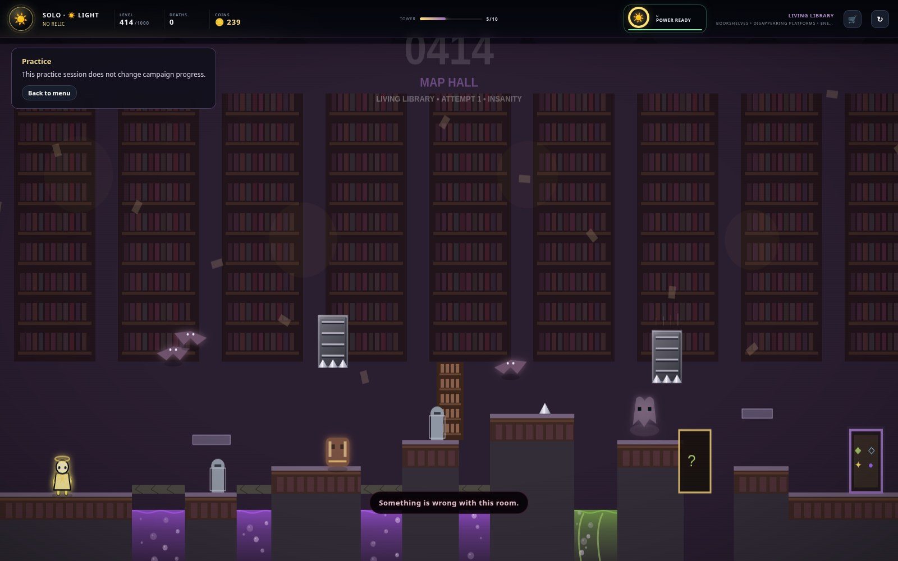
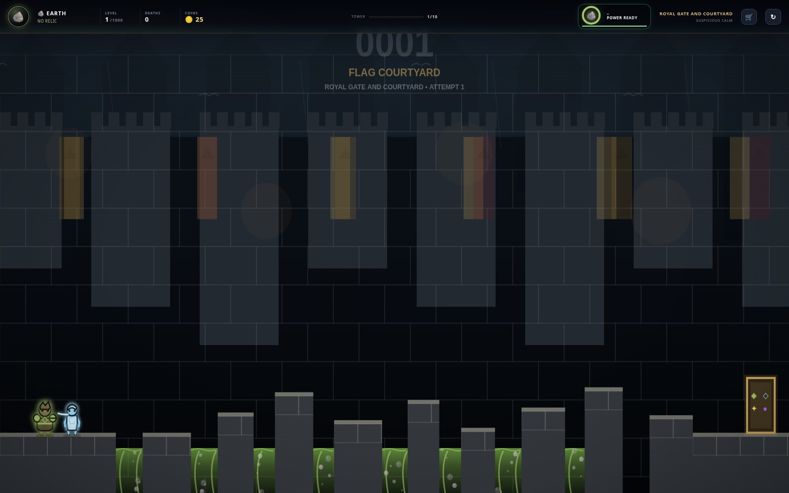
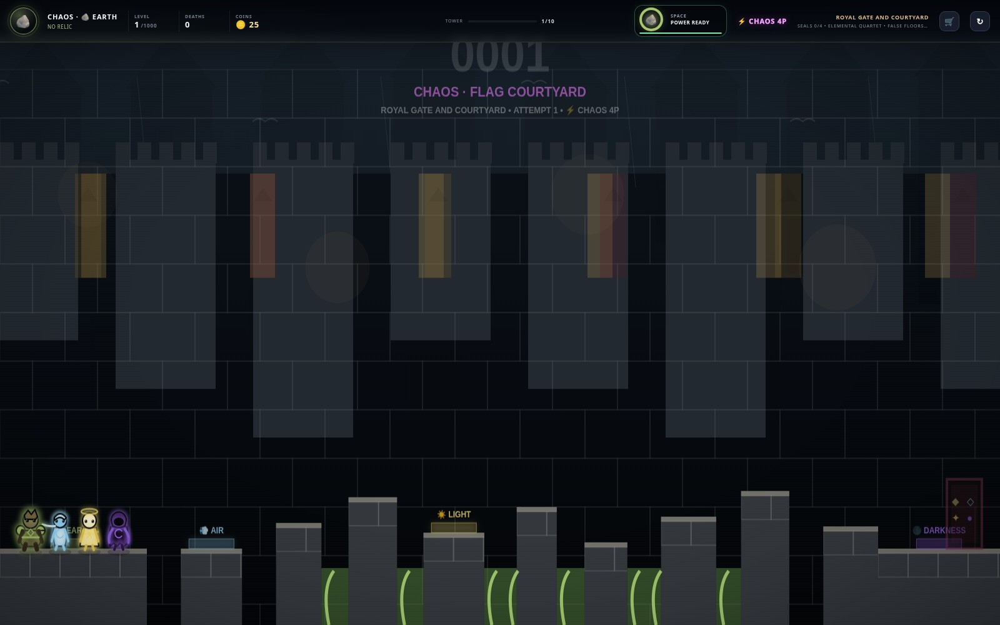
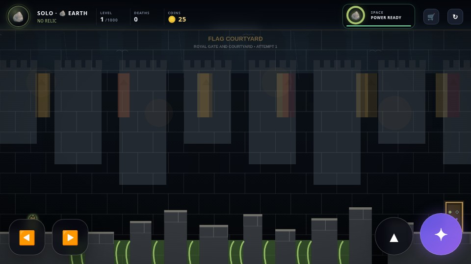
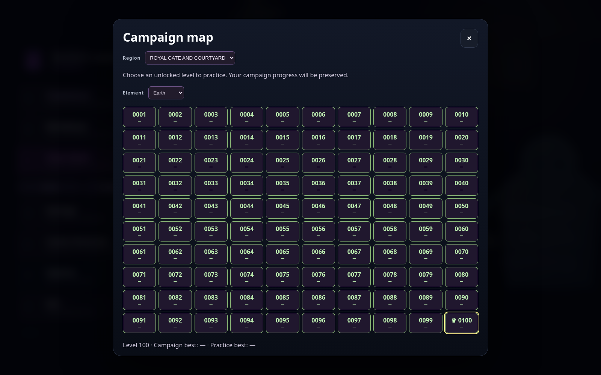
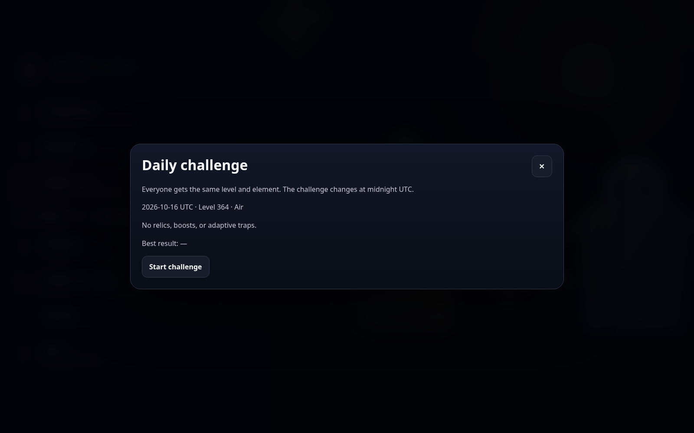
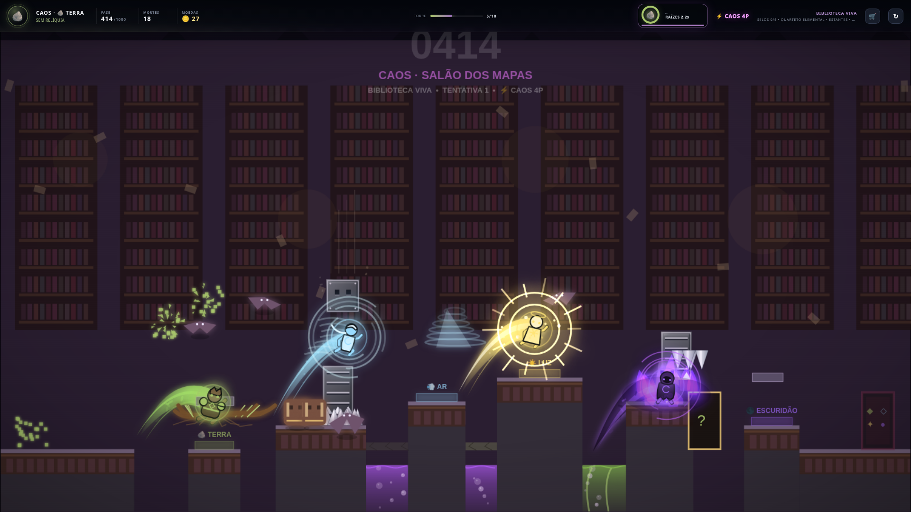

# Infinity Castle Elements — INSANITY 0.0.9

**Infinity Castle Elements** is an original troll platformer, action, and survival game by **NYX PROJECT R**. Climb a campaign of **1,000 levels**, master four playable elements, and face enemies, bosses, coins, a shop, boosts, cosmetics, and a castle that learns to hate you back. Play solo, cooperate with a friend, or enter online **Chaos Mode with four players**.

**INSANITY 0.0.9 — Player Experience Update** adds a playable tutorial, 30-second multiplayer reconnection, campaign practice and local best times, customizable keyboard and touch controls, reactive procedural audio, a shared daily challenge, and richer elemental graphics. All 20 offline languages remain available, with terminology corrections and new activity text.

**INSANITY 0.0.7 — Visual Experience Update** brings a dark fantasy HUD, a dynamic camera, stronger elemental effects, cinematic deaths and bosses, visual tower progression, regional enemies, post-processing, and a special presentation for level 1000. It also includes an integrated **Update Hub** with release history, resumable downloads, SHA-256 verification, automatic backups, install-on-exit support, and a versioned multiplayer protocol. All systems introduced in 0.0.6 remain available.

**Current game version:** `0.0.9`

## Downloads

### Windows — 64 bit

| Edition | Download | How to use it |
| --- | --- | --- |
| Setup | [Infinity-Castle-Elements-Setup-0.0.9.exe](https://github.com/NyxPjct/Infinity-Castle-Elements/releases/download/v0.0.9/Infinity-Castle-Elements-Setup-0.0.9.exe) | Run the installer, choose a folder, and finish the wizard. Desktop and Start Menu shortcuts are available. |
| Portable | [Infinity-Castle-Elements-Portable-0.0.9.exe](https://github.com/NyxPjct/Infinity-Castle-Elements/releases/download/v0.0.9/Infinity-Castle-Elements-Portable-0.0.9.exe) | Run the executable directly; no installation is required. |
| Complete ZIP | [Infinity-Castle-Elements-Windows-0.0.9.zip](https://github.com/NyxPjct/Infinity-Castle-Elements/releases/download/v0.0.9/Infinity-Castle-Elements-Windows-0.0.9.zip) | Extract the archive to access both Setup and Portable. |

### Android

[Download Infinity-Castle-Elements-Android-0.0.9.apk](https://github.com/NyxPjct/Infinity-Castle-Elements/releases/download/v0.0.9/Infinity-Castle-Elements-Android-0.0.9.apk)

Play in **landscape orientation** to use the full canvas and touch controls.

[Browse all releases](https://github.com/NyxPjct/Infinity-Castle-Elements/releases)

The distributed game includes its runtime. **Players do not need to install Node.js, npm, Express, or Socket.IO separately.**

## How to change the game language

The game starts in **Brazilian Portuguese** by default. You can change the language without starting a new campaign:

1. Open the main menu and select **Configurações** (Settings).
2. Find **Idioma** (Language).
3. Select **English** or your preferred language from the list.
4. The interface updates immediately. Close Settings with **✕** to return to the menu.

During a level, press **ESC**, choose **Configurações**, and change **Idioma** in the same way. Close Settings and press **ESC** to resume playing. Your language preference is saved on the current device and restored the next time you open the game.

Available languages: Portuguese, English, Spanish, French, German, Italian, Dutch, Polish, Russian, Turkish, Japanese, Korean, Simplified Chinese, Traditional Chinese, Arabic, Hindi, Swedish, Danish, Finnish, and Czech.

Changing the language updates the menus, settings, element selection, HUD, shop, achievements, relics, lore, room messages, overlays, and text drawn on the game canvas. Translations are included locally and work offline.

Player names, room codes, version numbers, and externally published release notes retain their original content.

## 📸 Screenshots — INSANITY 0.0.9

The following captures show the current web build. The mobile image shows the responsive touch interface in a mobile browser viewport.

<table>
  <tr>
    <td><br /><strong>Main menu</strong></td>
    <td><br /><strong>Element selection</strong></td>
  </tr>
  <tr>
    <td><br /><strong>Singleplayer</strong></td>
    <td><br /><strong>Online co-op</strong></td>
  </tr>
  <tr>
    <td><br /><strong>Chaos Mode</strong></td>
    <td><br /><strong>Mobile touch interface</strong></td>
  </tr>
</table>

## What’s new in 0.0.9 — Player Experience Update

**Singleplayer activities:** open **Singleplayer** from the main menu to find **Tutorial**, **Mapa da campanha** (Campaign map), and **Desafio diário** (Daily challenge) below the campaign buttons. These activities belong to Singleplayer and are not available in Multiplayer or Chaos Mode. The corrected 0.0.9 menu fits standard desktop windows without a horizontal scrollbar; smaller screens keep a narrow, themed vertical scrollbar when needed.

- **Playable tutorial:** choose **Singleplayer → Tutorial**. Learn movement, jumping, elemental powers, and two-pressure-plate cooperation with a demonstration partner. Falling returns you to a checkpoint. Tutorial progress never replaces your campaign save.
- **30-second reconnection:** a dropped connection reserves the same slot and element for 30 seconds. The room waits, then restores positions, revealed traps, seals, defeated enemies, and power cooldowns. Reloading the same browser tab can also resume the reservation. Choosing Back to menu releases the slot immediately. Reservations are held in server memory and cannot survive a server restart.
- **Campaign map:** choose **Singleplayer → Mapa da campanha** (Campaign map), select a region, element, and unlocked level, then choose **Treinar fase** (Practice level). Crown icons mark bosses. Campaign and practice best times are kept separately. Existing saves unlock previously reached levels; detailed times start recording with 0.0.9.
- **Custom controls:** in **Configurações → Controles**, select an action and press a new key. Conflicts and reserved interface keys are rejected; Escape cancels a binding and remains the pause/back key. **Controles de toque** lets you choose a touch button and adjust its size and horizontal/vertical position, with a preview. Reset controls restores the defaults.
- **Reactive audio:** original procedural sounds distinguish Earth, Air, Light, and Darkness. The music changes for bosses and pursuits. Master, music, and effects volumes and mute are saved under **Áudio**. Browser audio begins after a click, tap, or key press and stops when the game loses focus.
- **Daily challenge:** choose **Singleplayer → Desafio diário**. Everyone receives the same deterministic level and element for the same UTC date. The challenge changes at midnight UTC. Relics, boosts, and adaptive traps are disabled. Results are stored locally for up to 60 days; there is no global leaderboard. Daily play and practice do not spend campaign boosts, grant campaign rewards, or overwrite campaign progress.
- **Translation review:** Portuguese and English copy received an editorial pass, 18 locale glossaries were corrected, and all new messages are included offline. Independent native-speaker review remains open; see [localization review notes](./docs/LOCALIZATION.md).





**Server deployment:** 0.0.9 uses multiplayer protocol **3**. Deploy this version of `server.js` to the central server before playing online with 0.0.9 clients. The health endpoint reports the server version and protocol. Older incompatible clients are directed to update.

## Elemental graphics

Version 0.0.9 adds motion trails that follow each character's actual path while an elemental power is active: leaves and green ribbons for Earth, pale wind streams for Air, a golden comet trail for Light, and black and purple fragments for Darkness. Running and jumping use articulated poses, while traps have beveled metal, falling debris, speed streaks, and dust on impact. Hazard pools have shaded surfaces, waves, and rising bubbles.

Effects also appear on the other players in online co-op and Chaos Mode. The added trails, impact particles, and pool animations pause with the local game. Trails clear on room changes, teleports, and resume so players who moved during a pause do not leave a streak across the screen. **Settings → Reduce animations** disables trails and impact particles and stills the pools. Trail history and particle counts are limited. These changes affect presentation; the graphics keep collision geometry and movement rules unchanged.



This preview is composed in the game renderer with four local clients.

## What's new in 0.0.8 — In-game Language Update

- Complete text catalogs for all 20 language options.
- Immediate language changes across static and dynamic game text, including the canvas and illustration labels.
- Language preferences persist across restarts without changing campaign progress.
- Arabic uses right-to-left interface text.
- Translation works offline and requires no external translation service.
- Localization checks run before the Windows and Android packages are built.

The core labels and English copy were reviewed. Some translations were prepared automatically and can be refined over time.

## What's new in 0.0.7 — Visual Experience Update

This update focuses on presentation, visual feedback, and readability without changing the geometry, hitboxes, or underlying difficulty of the 1,000 levels.

### 🎮 Dark fantasy HUD

The redesigned HUD follows the selected element's identity and color. It gives more prominence to the elemental icon and reorganizes level, deaths, coins, and active relic information. **Visual tower progression** shows which of the ten regions you are in. Compact Shop and Restart buttons leave more space for gameplay.

### ✦ Circular elemental power indicator

A circular cooldown orb uses the current element's color. Its border shows active duration, cooldown, and readiness, while the HUD also displays the time remaining in seconds.

### 🎥 Dynamic camera

The camera subtly widens during fast movement, responds to chase levels, changes framing for boss introductions, and zooms in during deaths. Configurable screen shake remains available. These effects preserve the readability of jumps and traps.

### 🌱🌪️☀️🌑 Stronger elemental effects

- **Earth:** fuller roots, floor cracks, and fragment impacts.
- **Air:** wind streaks, spirals, directional particles, and displacement effects.
- **Light:** solar bloom, rings, rays, and orbiting particles.
- **Darkness:** denser black fire, smoke, unstable rings, and small glitches.

Enemies defeated by abilities use effects matching the attacking element.

### 👤 Shadows and depth

Characters, remote players, enemies, and bosses cast simple ground shadows, making height easier to read without a heavy 3D lighting system.

### 👹 Regional enemy identities

Enemy appearances, colors, and small details follow the current castle region. Sentinels, bats, and apparitions reflect the Dungeons, Library, Gardens, Crimson Throne, Impossible Heart, and other sectors while retaining their behaviors and hitboxes.

### ⚠️ Trap feedback

Traps that have **already been triggered** can show dust, vibration, particles, or signs on suspended objects before the final impact. Untriggered traps are not revealed in advance.

### ☠️ Cinematic deaths

Deaths partially desaturate the scene, increase contrast and vignette effects, emphasize a castle taunt, and add a small camera zoom. Anomaly and Joker Level deaths receive extra glitches. The 0.0.6 death replay continues to work alongside these effects.

### 👑 Cinematic boss introductions

Guardian rooms briefly display cinematic bars, a special camera framing, the boss's name and element, and an arena styled after the guardian. Normal gameplay framing returns after the introduction.

### 🏆 Animated level ranks

Level results receive effects matching **S, A, B, C, D**, or **THE CASTLE HATES YOU**. Higher ranks get their own glow and entrance; the final rank has a deliberately unstable appearance.

### 🏰 A main menu that reacts to progress

The menu reads the highest saved campaign progress and displays the highest level, current region, a ten-section tower bar, and the castle's state. Its appearance becomes darker and more corrupted as you climb.

### 🎭 Element selection feedback

The four character silhouettes respond to selection with their own glow and atmosphere, reinforcing each element's identity before a level begins.

### ✨ More visible cosmetics

The **Elemental Aura** leaves an elemental trail during fast movement. Crown, Aura, and visible relics remain compatible with the character redesign.

### 🚪 Secret rooms and collectibles

Secret room entrances gain a glowing floating fragment, making discoveries more rewarding without revealing secrets before the game allows them to appear.

### 🌈 Post-processing and anomalies

Regions feature subtle vignettes, contrast changes, atmospheric flashes, soft scanlines, Joker and anomaly glitches, and stronger corruption near the end. Reduced-motion settings remain respected for interface animations.

### ❤️‍🔥 Level 1000 — The Heart of the Castle

The final room has floating fragments of previous regions, mixed elemental colors, a glowing pulse around the Heart, and a quieter HUD. The presentation suggests all ten regions collapsing into the same space.

### 🔧 Gameplay compatibility

Character and platform hitboxes, trap positions, elemental physics, level routes, singleplayer logic, two-player co-op, four-player Chaos Mode, and trap synchronization keep their existing behavior.

### ⬇ Update Hub

**Updates** now has its own main menu entry instead of being inside Settings. Features include:

- A new-version notice shown **once per version** rather than on every return to the menu.
- Installed and available versions, file size, download status, and release highlights.
- GitHub notes grouped into New, Visual, Multiplayer, Fixes, and other categories.
- A history of recent releases.
- Desktop downloads that continue in the background while you play.
- Resumable interrupted downloads.
- **SHA-256** checks when GitHub supplies the official digest.
- Automatic local backups of saves, profiles, and settings before desktop installation.
- **Restart and install** and **Install on exit** options.
- In-game Portable downloads and replacement with a backup of the previous executable.
- A one-time welcome screen after an update.
- Service worker updates and reloads for the web version.
- Links to the official release APK on Android.
- Versioned save schemas to support future migrations.

### ⚡ Multiplayer version compatibility

The game version and online compatibility are tracked separately. Multiplayer uses its own protocol; outdated clients receive **UPDATE_REQUIRED** and are directed to the Update Hub. Singleplayer stays available. The Chaos integration test also verifies that clients using an old protocol are rejected.

### ✅ 0.0.7 validation

The official pipeline checks JavaScript syntax, audits all **1,000 levels**, exercises rendering and runtime behavior, and tests multiplayer and four-player Chaos Mode.

## What's new in 0.0.6 — The Castle Remembers

Version **0.0.6** expanded horror, progression, challenges, and dynamic castle behavior while retaining Singleplayer, Multiplayer, and Chaos 4P.

### 🎭 Character Visual Overhaul

The four characters were redesigned without changing physics, collision, or campaign balance. The gameplay hitbox remains **42×56**.

- **Earth** has a broad, heavy silhouette, rocky shoulders, and a sturdy body.
- **Air** has a slimmer body, a light cape, and a scarf that reacts to movement.
- **Light** has an elegant robe, a halo, and radiant details.
- **Darkness** has a hood, a partially hidden face, an uneven hem, and the appearance of a living shadow.
- Procedural idle, running, jumping, falling, and landing animations include leaning and brief compression on landing.
- Eyes react to movement, threats, powers, and special events.
- Chest symbols and dark outlines help identify characters in multiplayer and busy scenes.
- Each of the six equipped relics appears physically on the character.
- Visual corruption develops in later regions, with extra anomalies in level 666.
- Crown, Aura, death replays, and the Joker Level Echo clone use the new renderer.
- Multiplayer shares motion, grounded state, direction, and the active relic for consistent remote animations.
- Element selection uses four distinct miniature silhouettes.

### 🏰 Castle Visual Overhaul

All ten regions received their own atmosphere, weather, story details, platform materials, depth, and parallax without changing level geometry or collisions.

- **Royal Gate and Courtyard:** walls, flags, birds, and overgrown stone.
- **Noble Gallery:** stained glass, portraits, frames, and watchful eyes.
- **Deep Dungeons:** chains, bars, dampness, water, and low fog.
- **Clock Tower:** gears, mechanisms, and a large moving pendulum.
- **Living Library:** deep shelves, flying pages, and presences between the books.
- **Haunted Chapel:** arches, candles, light beams, and distant apparitions.
- **Hanging Gardens:** foliage, moving leaves, roots, and suspended ruins.
- **Storm Battlements:** clouds, rain, lightning, and a sense of height.
- **Crimson Throne:** embers, torn banners, aggressive architecture, and red veins.
- **Impossible Heart:** floating geometry and increasingly unnatural architecture.

Dynamic ambient lighting, guardian-themed arenas, larger region introductions, foreground atmosphere, and progressive corruption reinforce the new visuals. Fragments of earlier regions appear in unexpected places near level 1000. Level 666 keeps its special identity. Exits and gates match their regions while retaining their collision areas. **Platforms, jumps, traps, and routes keep their original geometry.**

### Evolved Joker Levels

Special **Joker Levels** can combine **one to three curses**: inverted controls, blackouts, heavy gravity, unstable or light gravity, a mirrored world, closing walls, and **Echo**, a delayed clone of the player. Inverted controls remain exclusive to Joker Levels and do not occur in normal levels.

### Adaptive castle

After repeated attempts, the castle can place new threats along frequently used routes. Multiplayer uses shared room events to keep these traps synchronized.

### Castle whispers

Contextual taunts respond to repeated deaths, multiple attempts, special rooms, the Pursuer, anomalies, and unique events in level 666, suggesting that the castle is watching you.

### Rare anomalies

Rare rooms can contain background observers, hidden eyes, incorrect room numbers, unusual silence and darkness, or disappearing doors. These events are not part of every level's normal structure.

### The Pursuer

A recurring entity first appears in the distance. In later rooms, it can emerge from the background and chase you. Surviving such a room can unlock an achievement.

### Elemental bosses

Guardians can use Earth, Air, Light, or Darkness affinities with corresponding attack patterns. The existing rune and ritual system remains in place.

### Chase levels

A moving wall of corruption forces you to keep moving and reach the exit before it catches you.

### Secret rooms

Hidden entrances can reward exploration with coins, lore fragments, relics, and achievements.

### Relics

Only **one relic can be active at a time**. Finding another equips it automatically.

| Relic | Effect |
| --- | --- |
| 🫀 Fractured Heart | Can prevent one death per level. |
| 🪽 Windstep | Increases maximum speed and acceleration by 8%. |
| 🪶 Abyss Feather | Increases jump strength by 8%. |
| ⌛ Chronoglass | Reduces elemental ability cooldown by 10%. |
| 👁️ Eye of Greed | Increases coin rewards by 25%. |
| ◉ Seer's Mark | Helps reveal secret rooms and anomalies. |

### Suffering ranks

Completion results consider time, deaths, attempts, and special room difficulty. Available ranks are **S · A · B · C · D · THE CASTLE HATES YOU**.

### Achievements

Local achievements reward your first death, large death counts, a deathless Joker Level, a secret room, a defeated guardian, entering level 666, surviving the Pursuer, completing a Chaos room, and finishing all 1,000 levels.

### Level 666

Level **666** has a dedicated layout instead of the usual procedural generation. It features a special scene, a hidden HUD, a distinctive atmosphere, background eyes, an observing entity, exclusive messages, and its own achievement. It remains part of normal campaign progression.

### Death replay

When possible, the game stores the character's last movements and shows a short visual replay after death, highlighting the route taken before a trap struck.

### Castle Chronicles

The main menu's **Castle Chronicles** displays achievements, discovered and equipped relics, lore fragments, general statistics, and your best rank.

### Alternate endings

The ending depends on campaign history, deaths, discoveries, and achievements:

- **Ending — The Door of Infinity**
- **True Ending — The Castle Remembers**
- **Cursed Ending — You Became Part of It**

### Multiplayer and Chaos Mode

Adaptive traps remain shared and synchronized. Elemental boss rituals, campaign saves, achievements, and progression systems coexist with two-player co-op and Chaos 4P. A death grants **+5 coins only to the player who died**, even when the shared attempt restarts for everyone.

### 0.0.6 validation

Before publication, the official pipeline checked JavaScript syntax, all 1,000 levels, structural validity, runtime behavior for all four elements, and multiplayer / Chaos 4P, then built the Windows and Android packages. The published game was **Infinity Castle Elements — INSANITY 0.0.6**.

## What's new in 0.0.5

### 🛠️ Startup hotfix

- Fixed `SyntaxError: missing ) after argument list` in `desktop/main.cjs` and the updater's PowerShell strings.
- Added `node --check desktop/main.cjs` to the Windows workflow so a release cannot publish an executable with a main-process syntax error.
- Players whose 0.0.4 installation would not open needed to install **Setup 0.0.5** manually once.
- Traps revealed by a multiplayer player became authoritative room state, replicated to every client for the current attempt.
- Surprise spikes, trap walls, and other shared traps remain consistent across clients.
- Corrected death rewards to **+5 coins only for the player who died**.

### 📱 Mobile / Android

The new **Android 0.0.5** app uses Capacitor and the same campaign, multiplayer, Chaos Mode, and central Railway server as desktop. Landscape fullscreen and touch controls support movement, jumping, and elemental abilities. The interface displays the actual game version instead of the old `0.0.2` label. GitHub Actions builds the APK and publishes it with the corresponding release.

## What's new in 0.0.4

### 🔄 Updater fixes

The updater stopped repeatedly requesting the same update. It waits for the old process to exit, applies a silent update to the current installation, verifies the installed version before reopening, and automatically starts the new version. A local installation log helps diagnose failures. The Windows workflow reads the version from `package.json` to avoid outdated release numbers.

## What's new in 0.0.3

### 🃏 Joker Levels

Joker rooms appear deterministically throughout the campaign and are marked on the HUD. They feature watchful eyes, crooked portraits, tears in reality, and an unsettling atmosphere. Inverted controls are limited to these rooms, and **no element is immune, including Darkness**. Boss rooms remain outside the Joker rotation.

### 🔗 Synchronized multiplayer traps

Surprise and pop-up spikes, false floors, breakable bridges, disappearing platforms, chandeliers, falling blocks, sudden walls, moving exits, and fake exits share their state. When one player triggers a trap, everyone receives the room event and sees the change. The server retains trap state for the current attempt and clears it on restart, in both two-player co-op and Chaos 4P.

### ⚡ Four-player Chaos Mode

- Four players must be present and ready.
- Earth, Air, Light, and Darkness must all be represented; duplicate elements are not allowed.
- Each normal room has four elemental seals, and each player activates their own element's seal.
- The exit stays locked until all four seals are active.
- Bosses require four simultaneous runes.
- One death restarts the attempt for the whole group.
- Additional enemies increase the pressure.
- State and visuals synchronize across up to four characters.
- Chaos has a separate campaign save and a Continue option that creates a new online room at the saved level.

### 🌐 Online multiplayer

The central multiplayer server is hosted on **Railway**. Players on different computers can join private rooms over the internet using room codes, without running a server or leaving a PC acting as host. Two-player and four-player campaigns remain separate, with persistent saves for all three modes.

### ⬇ In-game updates

GitHub Releases powers automatic version checks, menu notices, release notes, download progress, restart-and-install support, and save preservation. In 0.0.7 these features moved to the dedicated Update Hub.

### 🎮 Revised controls

Movement uses **A / D** or **← / →**, jumping uses **W** or **↑**, and **Space** activates your ability. **E** no longer activates powers. **R**, **ESC**, and **F11** retain their functions.

### ✨ Elemental abilities

Each ability has a distinct animation, active duration, range, target limit, and visible cooldown. **Cooldown lasts five seconds after the effect ends.**

| Element | Ability | Duration | Maximum targets | Behavior |
| --- | --- | --- | --- | --- |
| Earth | Roots of the Abyss | 1.9s | 2 | Roots seek nearby enemies from the floor. |
| Air | Mini Hurricane | 2.2s | 2 | A tornado travels in the facing direction while air mobility improves. |
| Light | Solar Crown | 2.8s | 3 | A pulsing solar aura attacks nearby enemies. |
| Darkness | Black Fire | 2.6s | 2 | Black and purple flames attack nearby enemies. |

Light and Darkness receive only brief initial defensive protection, rather than invulnerability for the full duration. Limits preserve the INSANITY difficulty.

### 💾 Retained improvements

A Return to Main Menu button is available in multiplayer rooms. Desktop saves persist between sessions. Every death awards five coins only to the player who died.

## Opening and identity

The presentation has three stages:

1. A black **NYX PROJECT R** studio screen with its purple owl, red eyes, and **Presents** signature.
2. The cinematic **INFINITY CASTLE ELEMENTS — INSANITY** title screen, introducing the four elements and the campaign's dark fantasy atmosphere.
3. The main menu: **Singleplayer, Multiplayer, Chaos Mode, Settings, Castle Chronicles, Updates, and Exit**. The Arcane Shop remains available inside the game.

The current identity combines the 0.0.6 character and castle redesigns, Chronicles, Joker Levels, anomalies, the Pursuer, and level 666 with 0.0.7's cinematic HUD, camera, effects, tower progress, final-room treatment, and Update Hub. On desktop, **Exit** closes the game directly.

## The 1,000-level campaign

The campaign runs from level **1 to 1000**. INSANITY difficulty escalates from **level 5**. Traps are deterministic: die, learn what happened, and try a better route. The generator uses **12 layout archetypes**, **10 regions**, and **10 bosses**, one every 100 levels.

### Regions

| Levels | Region |
| --- | --- |
| 001–100 | Royal Gate and Courtyard |
| 101–200 | Noble Gallery |
| 201–300 | Deep Dungeons |
| 301–400 | Clock Tower |
| 401–500 | Living Library |
| 501–600 | Haunted Chapel |
| 601–700 | Hanging Gardens |
| 701–800 | Storm Battlements |
| 801–900 | Crimson Throne |
| 901–1000 | Impossible Heart |

## Playable elements

### 🪨 Earth

Heavier and more controlled, resistant to roots, and equipped with **Roots of the Abyss**. Press **Space** to summon roots toward nearby enemies: **1.9 seconds**, up to **two targets**, and **five seconds of cooldown after the effect ends**.

### 💨 Air

Faster and more mobile, immune to storms, and equipped with **Mini Hurricane**. Press **Space** to send a tornado in your facing direction and temporarily improve aerial mobility: **2.2 seconds**, up to **two enemies**, and **five seconds of cooldown after the effect ends**.

### ☀️ Light

Resistant to curses and equipped with **Solar Crown**. Press **Space** to surround yourself with a pulsing aura: **2.8 seconds**, up to **three enemies**, and **five seconds of cooldown after the effect ends**. Defensive protection lasts only briefly at activation.

### 🌑 Darkness

Ignores inverted-control zones and uses **Black Fire**. Press **Space** to emit black and purple flames: **2.6 seconds**, up to **two enemies**, a brief initial phase/protection window, and **five seconds of cooldown after the effect ends**.

## Singleplayer

Choose **one element** before starting. Gates, plates, and boss rituals adapt so the campaign remains possible with one character. Use the four elemental characters on the setup screen to select your element. Solo progress includes your level, deaths, element, coins, boosts, and cosmetics.

## Multiplayer

Two-player co-op uses private rooms with codes and independent element selection, including duplicate elements. Players, levels, deaths, bosses, runes, defeated enemies, traps, and restarts synchronize through the project's online Railway server. A saved campaign creates a new room at the saved level when resumed.

## Chaos Mode — four players

The room requires **Earth, Air, Light, and Darkness**, with one player per element. All four must be present and ready. Each room requires four elemental seals before the exit opens; each player can activate only their own seal. Boss rituals require all four elemental runes simultaneously. One death restarts everyone's attempt, and extra enemies increase the difficulty. Chaos progress has its own save, separate from solo and two-player co-op.

## Coins and the Arcane Shop

Earn coins by completing levels, defeating enemies, and dying. **In every mode, a death grants +5 coins only to the player who died.** Other players receive no coins for that death.

Shop items include:

- **Shield Rune:** absorbs a fatal hit.
- **Wind Boots:** temporarily increases speed.
- **Arcane Jump:** temporarily increases jump strength.
- **Castle Crown:** a permanent cosmetic.
- **Elemental Aura:** a permanent cosmetic.

## Enemies and threats

The campaign includes sentinels, bats, specters, living armor, ghosts, dragons, projectiles, and falling objects. Threat counts and combinations increase as you climb.

## INSANITY traps

Expect false floors, disappearing platforms, breakable bridges, ordinary and surprise spikes, ceiling spikes, fake exits, fleeing exits, fake doors, falling blocks and chandeliers, advancing walls, crushers, elevators, moving bookshelves, Joker-only inverted controls, wind gusts, ghosts, living armor, dragons, projectiles, and combinations of several tricks in one room.

## Bosses

Bosses appear in levels **100, 200, 300, 400, 500, 600, 700, 800, 900, and 1000**. Barriers, runes, rituals, projectiles, and arenas adapt to the chosen mode.

## Protection against impossible levels

The generator protects spawn points, exits, plates, gates, runes, and required routes. If a layout fails structural validation, an **emergency room** replaces it with a safe layout.

## Level auditing

The built-in audit checks **1,000 levels**, **10 bosses**, **240 levels with gates**, **12 archetypes**, and **10 regions**. It exercises level rendering, runtime behavior for all four elements, and critical spawn and exit areas.

## Settings and pause menu

Desktop starts **fullscreen by default**. Settings offers native resolution, 4K, 1440p, 1080p, 1600×900, 1366×768, and 720p, plus language, fullscreen, screen shake, and reduced animations.

Press **ESC** during a level to pause. You can **Save game**, open **Settings**, **Exit to menu**, or **Exit to desktop**. Press **ESC** again to continue.

## Controls

| Input | Action |
| --- | --- |
| A / D or ← / → | Move |
| W or ↑ | Jump |
| Space | Elemental ability |
| R | Restart level |
| ESC | Open or close pause menu |
| F11 | Toggle fullscreen |

Since 0.0.3, abilities use **Space** instead of **E**.

## System requirements

Recommended for the official Windows release:

- **Windows 10 or Windows 11, 64 bit**
- **x64 processor**
- **4 GB RAM or more**
- Compatible graphics acceleration
- Free space for the game and local saves
- Internet access for online multiplayer and updates

### Technologies

The game uses **Electron, Node.js, JavaScript, HTML5, CSS, Canvas 2D, Express, and Socket.IO**. These are included in the distributed application.

### Windows SmartScreen

The 0.0 series does not yet use a commercial code-signing certificate. Depending on Windows settings, SmartScreen may show an **unknown publisher** warning on first launch.

## Development

Install **Node.js 20 or newer**, then run from the repository directory:

```sh
npm install
npm start
```

The local web server uses port **3000** by default; set `PORT` to choose another port. Use `npm run dev` for watch mode.

```sh
npm run test:levels
npm run test:chaos
npm run test:i18n
npm run test:visuals
npm run test:features
npm run test:reconnect
# Once, if a system Chrome/Chromium is unavailable:
npx playwright-core install --with-deps chromium
npm run test:browser
```

The first command audits all 1,000 levels. The second tests live Socket.IO multiplayer, Chaos Mode, synchronized traps, death rewards, and protocol compatibility. The third verifies all 20 language catalogs, placeholders, dynamic messages, canvas text, and repeated language switching.

The fourth checks visual effect lifecycles, four-element trails, landing and trap impacts, pause/resume, teleports, reduced motion, canvas state isolation, and memory limits. Feature tests cover deterministic UTC challenges, practice records, input configuration, and WebAudio scheduling. Reconnection tests exercise real 2P/4P sockets and the full 30-second expiry. Chromium tests exercise playable tutorial inputs, campaign save isolation, boss practice, saved controls and audio, offline activities, touch input, and disconnect/reload recovery. Set `CHROMIUM_PATH` to select an installed Chrome or Chromium executable.

Game translations are bundled in `public/translations.js`; keep the Portuguese source keys and numbered placeholders when refining a translation.

Optional platform workflows: `npm run desktop` for Electron, `npm run dist:win` for Windows packaging, and the `mobile:*` scripts for Capacitor Android development. Android requires its SDK and native build tools.
